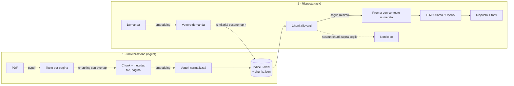

# rag-pdf-qa

[](https://github.com/dottssacarroneantonella-webDeveloper/rag-pdf-qa/actions/workflows/tests.yml)


**Domande e risposte sui tuoi documenti PDF con Retrieval-Augmented Generation (RAG).**
Carichi dei PDF, fai una domanda in italiano e ottieni una risposta basata **solo** sul
contenuto dei documenti, con le **fonti citate** (file e pagina). Se l'informazione non
c'è, il sistema risponde "Non lo so" invece di inventare.

```text
# esempio di risposta con Ollama (llama3.2)
$ rag-pdf-qa ask "Quanto dura il prestito dei libri?"
La durata del prestito è di 30 giorni e può essere rinnovato una sola volta per altri
15 giorni [regolamento_biblioteca.pdf p.2].

Fonti: regolamento_biblioteca.pdf p.2
```

Tutto può girare **in locale e gratis**: embedding multilingue con sentence-transformers,
database vettoriale FAISS e modello linguistico con [Ollama](https://ollama.com). In
alternativa si può usare un'API compatibile con OpenAI.

---

## Indice

- [Cos'è il RAG](#cosè-il-rag)
- [Architettura](#architettura)
- [Installazione su Windows](#installazione-su-windows)
- [Uso](#uso)
- [Configurazione](#configurazione)
- [Scelte progettuali](#scelte-progettuali)
- [Test](#test)
- [Limiti e sviluppi futuri](#limiti-e-sviluppi-futuri)
- [Come lo spiegherei a un colloquio](#come-lo-spiegherei-a-un-colloquio)

## Cos'è il RAG

Un LLM conosce solo ciò che ha visto durante l'addestramento: non conosce i tuoi documenti
e, se non sa una cosa, tende a inventarla (*allucinazione*). Il **RAG** risolve il problema
in due fasi:

1. **Retrieval**: si cercano nei documenti i passaggi più pertinenti alla domanda;
2. **Generation**: si passano quei passaggi al modello insieme alla domanda, chiedendogli
   di rispondere solo sulla base di quel contesto e di citare le fonti.

Così il modello risponde con informazioni aggiornate e verificabili, senza bisogno di
riaddestrarlo.

## Architettura



| Modulo | Responsabilità |
| --- | --- |
| `loader.py` | Estrae il testo dei PDF pagina per pagina e lo ripulisce |
| `chunker.py` | Divide il testo in chunk sovrapposti rispettando paragrafi e frasi |
| `embeddings.py` | Interfaccia `Embedder`: `SentenceTransformerEmbedder` (semantico) e `TfidfEmbedder` (lessicale, offline) |
| `vector_store.py` | Interfaccia `VectorStore`: `FaissStore` e `NumpyStore`, con salvataggio su disco |
| `prompt.py` | Costruisce il prompt: regole, contesto numerato con le fonti, domanda |
| `llm.py` | Interfaccia `LLM`: `OllamaLLM`, `OpenAICompatibleLLM`, `EchoLLM` (estrattivo, per test) |
| `pipeline.py` | Orchestra `ingest` e `ask`, applica la soglia di similarità |
| `cli.py` / `api.py` | Riga di comando e API REST FastAPI |
| `config.py` | Configurazione da variabili d'ambiente / file `.env` |

Ogni componente è dietro un'interfaccia astratta con una *factory*: si può cambiare
embedder, database vettoriale o LLM da configurazione, senza toccare la pipeline.

## Installazione su Windows

Prerequisiti: [Python 3.10+](https://www.python.org/downloads/) (spunta *Add python.exe to PATH*)
e [Git](https://git-scm.com/download/win). Comandi da **PowerShell**:

```powershell
# 1. Scarica il progetto
git clone https://github.com/dottssacarroneantonella-webDeveloper/rag-pdf-qa.git
cd rag-pdf-qa

# 2. Crea e attiva un ambiente virtuale
python -m venv .venv
.\.venv\Scripts\Activate.ps1
# Se PowerShell blocca lo script: Set-ExecutionPolicy -Scope CurrentUser RemoteSigned

# 3. Installa il progetto con tutte le funzionalità
pip install -e ".[all]"

# 4. Crea il file di configurazione
Copy-Item .env.example .env
```

### LLM locale con Ollama (gratuito)

1. Scarica e installa Ollama da <https://ollama.com/download>.
2. Scarica un modello (circa 2 GB): `ollama pull llama3.2`
3. Ollama resta attivo in background su `http://localhost:11434`.

Su Linux/macOS i comandi sono gli stessi, ma l'ambiente si attiva con `source .venv/bin/activate`.

## Uso

```powershell
# Indicizza i PDF (un file o una cartella)
rag-pdf-qa ingest examples

# Fai una domanda
rag-pdf-qa ask "Quali sono gli orari di apertura della biblioteca?"

# Mostra anche i chunk recuperati e il loro punteggio
rag-pdf-qa ask "Quanto dura il prestito?" --show-context
```

Per indicizzare i tuoi documenti mettili in `data/pdf/` (la cartella `data/` non va su
GitHub) e lancia `rag-pdf-qa ingest data/pdf`.

### Prova immediata, senza scaricare modelli

TF-IDF ed `EchoLLM` funzionano offline in pochi secondi:

```powershell
rag-pdf-qa ingest examples --embedder tfidf --store numpy
rag-pdf-qa ask "Quanti posti ha la sala studio?" --llm echo
```

### API REST

```powershell
uvicorn rag_pdf_qa.api:app --reload
```

Documentazione interattiva su <http://127.0.0.1:8000/docs>.

```powershell
Invoke-RestMethod -Method Post -Uri http://127.0.0.1:8000/ask `
  -ContentType "application/json" -Body '{"question": "Quanto dura il prestito?"}'
```

L'endpoint `POST /ingest` indicizza solo cartelle dentro `data/pdf` (i percorsi tipo
`../` vengono rifiutati).

## Configurazione

Tutti i parametri si impostano nel file `.env` (vedi [`.env.example`](.env.example)) o
con le opzioni della riga di comando.

| Variabile | Default | Significato |
| --- | --- | --- |
| `RAG_EMBEDDER` | `sentence-transformers` | `sentence-transformers` oppure `tfidf` |
| `RAG_EMBEDDING_MODEL` | `paraphrase-multilingual-MiniLM-L12-v2` | modello multilingue, adatto all'italiano |
| `RAG_STORE` | `faiss` | `faiss` oppure `numpy` |
| `RAG_LLM` | `ollama` | `ollama`, `openai` oppure `echo` |
| `RAG_OLLAMA_MODEL` | `llama3.2` | qualunque modello scaricato con `ollama pull` |
| `RAG_OPENAI_API_KEY` | — | chiave per l'API compatibile OpenAI, **solo nel `.env`** |
| `RAG_CHUNK_SIZE` / `RAG_CHUNK_OVERLAP` | `800` / `150` | dimensione dei chunk e sovrapposizione, in caratteri |
| `RAG_TOP_K` | `4` | quanti chunk passare al modello |
| `RAG_MIN_SCORE` | 0.30 semantico, 0.10 TF-IDF | sotto questa similarità la risposta è "Non lo so" |

## Scelte progettuali

**RAG invece di fine-tuning.** Il fine-tuning insegna al modello uno stile o un compito,
ma è costoso, va ripetuto a ogni aggiornamento dei documenti e non permette di citare le
fonti. Con il RAG basta reindicizzare i PDF e ogni risposta è verificabile.

**Chunking con overlap.** I chunk da circa 800 caratteri sono abbastanza piccoli da
essere precisi e abbastanza grandi da contenere un concetto completo. Il chunker spezza
prima sui paragrafi, poi sulle frasi, poi sulle parole; ogni chunk riparte con gli ultimi
150 caratteri del precedente, così un'informazione a cavallo tra due chunk non si perde.
Ogni chunk conserva file e pagina per poter citare la fonte.

**Embedding multilingue normalizzati.** `paraphrase-multilingual-MiniLM-L12-v2` è
leggero, gira su CPU e capisce l'italiano. I vettori sono normalizzati, quindi il
prodotto scalare coincide con la similarità coseno e si può usare `IndexFlatIP` di FAISS.

**FAISS con ricerca esatta.** Per qualche migliaio di chunk la ricerca esatta è già
istantanea. Con milioni di vettori si passerebbe a un indice approssimato (`IVF`, `HNSW`).
`NumpyStore` offre la stessa interfaccia senza dipendenze.

**Soglia di similarità e "Non lo so".** Se nessun chunk supera la soglia, la pipeline
risponde "Non lo so" **senza chiamare l'LLM**: si evitano allucinazioni e costi inutili.
Il prompt chiede inoltre di usare solo il contesto e di citare le fonti.

**Difesa dalla prompt injection.** Il contesto è racchiuso tra delimitatori ed è
dichiarato come "dati e non istruzioni", separato dalle regole di sistema.

**Sicurezza.** Nessuna chiave nel codice: la chiave API si legge da `.env`, escluso da Git.
L'API valida gli input con Pydantic e impedisce di indicizzare percorsi fuori da `data/pdf`.

**TF-IDF ed EchoLLM.** Servono a test riproducibili e veloci (nessun download, nessuna
rete) e come *baseline*. TF-IDF trova solo parole uguali: la domanda "Come mi iscrivo?"
non trova l'articolo sull'"iscrizione", mentre gli embedding semantici sono pensati per
cogliere questa somiglianza di significato.

## Test

```powershell
pip install -e ".[dev]"
pytest
```

I test girano offline con TF-IDF, NumPy ed `EchoLLM`. Coprono:

- loader, chunker, embedding, database vettoriale (salvataggio e ricaricamento compresi);
- client LLM, con risposte HTTP simulate;
- pipeline completa: risposta corretta e pagina giusta citata, "Non lo so" per una domanda
  fuori tema;
- CLI e API.

GitHub Actions li esegue a ogni push su Python 3.10 e 3.12, con FAISS e FastAPI installati.

Il PDF di esempio (`examples/regolamento_biblioteca.pdf`, documento fittizio) si rigenera
con `python scripts/make_example_pdfs.py`.

## Limiti e sviluppi futuri

- PDF scansionati: senza OCR non c'è testo da estrarre (si potrebbe aggiungere Tesseract).
- Tabelle e layout complessi perdono struttura con l'estrazione di testo semplice.
- **Ricerca ibrida**: unire BM25 (parole esatte, codici, nomi) ed embedding semantici.
- **Re-ranking** dei chunk recuperati con un cross-encoder per aumentare la precisione.
- **Valutazione** automatica su un set di domande e risposte attese (per esempio con
  RAGAS): pertinenza del contesto, fedeltà della risposta, correttezza.
- Indicizzazione incrementale (oggi l'indice viene ricostruito da zero) e interfaccia
  web (Streamlit o React).

## Come lo spiegherei a un colloquio

> "È un sistema RAG per fare domande sui PDF. In fase di indicizzazione estraggo il testo
> pagina per pagina, lo divido in chunk sovrapposti di circa 800 caratteri tenendo file e
> pagina, calcolo gli embedding con un modello multilingue e li salvo in un indice FAISS.
> Quando arriva una domanda calcolo il suo embedding, recupero i quattro chunk più simili
> per similarità coseno e, se superano una soglia, li passo all'LLM in un prompt che gli
> impone di usare solo quel contesto e di citare le fonti; altrimenti rispondo 'non lo so'
> senza chiamare il modello. Ogni componente è dietro un'interfaccia, quindi posso
> cambiare embedder, database vettoriale o LLM, per esempio da Ollama in locale ad Azure
> OpenAI, solo da configurazione. I test girano offline con TF-IDF e un LLM estrattivo e
> sono eseguiti in CI con GitHub Actions."

Domande che potrebbero seguire:

- *Perché il RAG e non il fine-tuning?* Vedi [Scelte progettuali](#scelte-progettuali).
- *Come sceglieresti la dimensione dei chunk?* Con un set di domande di prova, misurando se
  il chunk giusto compare tra i primi k risultati (*recall@k*) al variare di dimensione e overlap.
- *Come ridurresti le allucinazioni?* Soglia di similarità, prompt vincolato al contesto,
  temperatura bassa, citazioni obbligatorie, valutazione della fedeltà della risposta.
- *Come lo porteresti in produzione?* API containerizzata, database vettoriale gestito
  (pgvector, Azure AI Search), indicizzazione incrementale, logging e monitoraggio di
  latenza, costi e qualità delle risposte.

## Licenza

[MIT](LICENSE)
